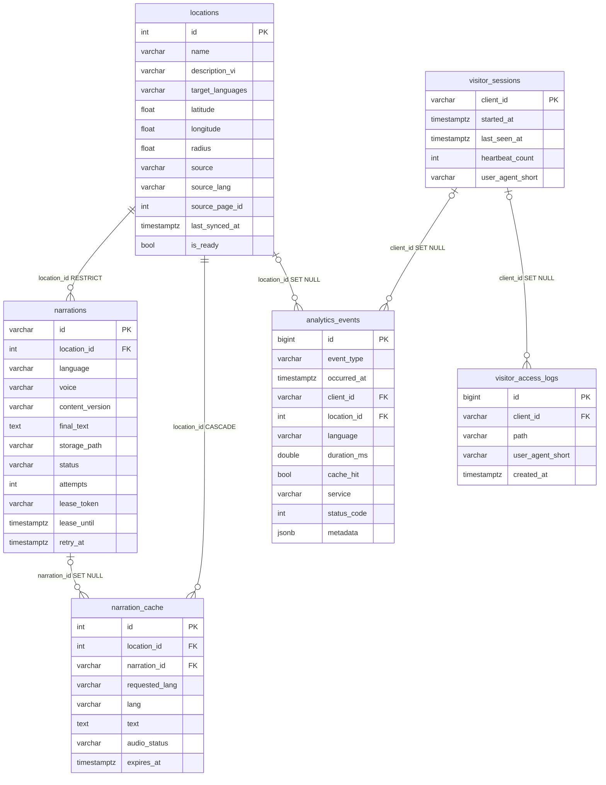

# Báo cáo thiết kế lại Supabase theo DFD mức 1 (Nhiệm vụ 1/3)

Phạm vi: chỉ phân tích và SQL. Không sửa mã Python. Không có quyền truy cập Supabase nên mọi kết luận về
"hiện trạng" dựa trên `docs/supabase-schema.sql` và mã nguồn trong repo; chưa đối chiếu với dữ liệu thật.

Kiểm thử đã làm: chạy toàn bộ SQL trên PostgreSQL 16 giả lập Supabase (role `anon`/`authenticated`/`service_role`,
`storage.buckets`). Kết quả: 001 và 002 chạy lặp 2 lần không lỗi; DB cũ có dữ liệu mẫu sau 001+002 có schema
trùng khớp 100% (kể cả quyền và policy) với DB mới tạo từ `supabase-schema.sql`; trigger, ràng buộc, làm sạch
dữ liệu nhạy cảm, hàm Dashboard và phân quyền theo vai trò đều đã chạy thử. Chưa thử trên Supabase thật
(khác biệt có thể có: phiên bản PostgreSQL, quyền sở hữu `storage.objects`).

## 1. Báo cáo hiện trạng

### 1.1 Bảng đang có và đang được dùng

| Nơi lưu | Bảng | Đang tồn tại | Đang được code dùng |
|---|---|---|---|
| Supabase (theo `docs/supabase-schema.sql`) | `locations` | Có | Có: `content-service/main.py`, `models.py`, `narration_store.py` (set `is_ready`) |
| | `narrations` | Có | Có: `narration_store.py` (claim/save/invalidate), `narration_pipeline.py` |
| | `narration_cache` | Có | Có: các route `/locations/{id}/narrations/{lang}`, `mark-ready`, xóa địa điểm |
| | `visitor_access_logs` | Có | Có, chỉ ghi và đếm: `analytics_store._sync_visit_to_supabase`, `_fetch_supabase_visitor_count` |
| | Bucket `narration-audio` | Có (private) | Có: `narration_clients.py` upload, kiểm tra tồn tại, ký URL 3600 giây |
| SQLite cục bộ `analytics.db` (Gateway) | `visitor_sessions`, `page_views`, `location_events`, `narration_events`, `error_logs` | Chỉ trong SQLite, **chưa có trên Supabase** | Có: toàn bộ `analytics_store.py` |
| SQLite cục bộ `content.db` | `locations`, `narration_cache`, `schema_migrations` | Chỉ chế độ local/test (không có `DATABASE_URL`) | Có khi chạy local và test |

### 1.2 Cột được code tham chiếu

- `locations`: toàn bộ 15 cột đều có trong `models.Location`. Cột nhạy cảm với thay đổi: `source`, `source_lang`, `source_page_id` (khóa unique), `latitude`, `longitude`, `radius`, `is_ready`.
- `narrations`: toàn bộ 20 cột đều được dùng. Khóa nhận diện phiên bản là `(location_id, language, voice, content_version)`; `claim()` dùng `ON CONFLICT` trên 4 cột này, nên unique constraint này **không được đổi**.
- `narrations.location_snapshot` là TEXT chứa JSON và code tự `json.loads`, kể cả `_tts.voice`. Không được đổi sang JSONB (psycopg sẽ trả `dict` và làm hỏng code).
- `narration_cache`: mọi cột đều nằm trong `NarrationCache.__table__.columns`; `narration_to_dict()` trả **tất cả cột trừ `id`** cho API cũ. Vì vậy không thể xóa các cột trùng (`text`, `voice`, `text_hash`, `audio_filename`).
- `visitor_access_logs`: code chỉ INSERT `(client_id, path, user_agent_short)` và đếm; `id`, `created_at` lấy giá trị mặc định.

### 1.3 Dữ liệu đang nằm ngoài Supabase

| Dữ liệu | Hiện ở đâu | Ghi chú |
|---|---|---|
| Phiên, page view, sự kiện địa điểm/thuyết minh, nhật ký lỗi | SQLite `analytics.db` (`/app/data` hoặc cạnh `analytics_store.py`) | Mất khi container Render không có disk bền vững; dọn sau 30 ngày |
| Bộ đếm đăng nhập sai | RAM (`admin_auth._failed_attempts`, khóa theo IP) | Khớp D7, giữ nguyên |
| Cache Wikimedia | RAM có TTL (theo mô tả D8) | Giữ nguyên |
| `client_id` ẩn danh | `localStorage` khóa `gps_anon_cid` (`app.js`) | Khớp D6 |
| GPS | Chỉ trong trình duyệt (`watchPosition`); Gateway nhận tọa độ để tìm điểm gần nhưng không lưu | Khớp D6 |

### 1.4 API bị ảnh hưởng khi đổi schema

| Dịch vụ | API | 001 | 002 (TIMESTAMPTZ) |
|---|---|---|---|
| Content | `POST /narrate`, `GET/PUT/DELETE /locations/{id}/narrations/{lang}`, `PATCH /locations/{id}/mark-ready`, CRUD `/locations`, `/locations/nearby`, `/locations/discover` | Không ảnh hưởng | **Có**: code so sánh datetime không múi giờ |
| Gateway | `POST /analytics/heartbeat`, `POST /analytics/pageview` | Không ảnh hưởng (vẫn ghi SQLite) | Không |
| Gateway | `POST /locations/detect` (ghi sự kiện) | Không ảnh hưởng | Không |
| Gateway admin | `{ADMIN}/`, `/api/summary`, `/api/chart`, `/api/locations`, `/api/errors`, `/login` | Không ảnh hưởng cho đến khi Prompt 2 chuyển `analytics_store.py` | Không |

### 1.5 Phát hiện cần lưu ý

1. **`narrations` đã bật RLS nhưng thiếu `REVOKE ALL ... FROM anon, authenticated`** (3 bảng còn lại đều có). RLS không có policy vẫn chặn truy cập, nhưng thiếu lớp bảo vệ thứ hai. 001 sửa việc này.
2. **Cột thời gian hiện là `TIMESTAMP WITHOUT TIME ZONE`** và mã Python phụ thuộc vào điều đó (`utcnow()` ở `main.py:369`, `now()` ở `narration_store.py:14`, `main.py:743, 758-766`). Yêu cầu TIMESTAMPTZ của bạn vì thế được tách làm 2 bước: 001 an toàn với mã hiện tại, 002 chỉ chạy sau Prompt 2.
3. `UNIQUE (source, source_lang, source_page_id)` **không chặn trùng khi một cột là NULL** (PostgreSQL coi NULL là khác nhau). Bài Wikimedia thiếu `source_page_id` vẫn trùng được. 001 thêm CHECK buộc bài Wikimedia phải đủ khóa và có GPS.
4. `is_ready` có hai nguồn ghi: `narration_store.save()` đặt `True` khi `narrations` ready, còn `_recompute_is_ready()` tính **chỉ từ `narration_cache`**. Có thể `PATCH mark-ready` hạ `is_ready` của địa điểm chỉ có `narrations`. Đây là vấn đề của code (Prompt 2), không phải của schema.
5. `main.py:857` ghi `ADMIN_LOGIN_FAIL` kèm **username người dùng gõ vào**. Nếu ai đó dán nhầm mật khẩu vào ô username thì nó vào log. Cần bỏ username khỏi thông báo.
6. Sự kiện thực sự được phát ra hiện nay chỉ có: `activated`, `tts_success`, `tts_fail`, lỗi, heartbeat, page view. Các loại `detected`, `searched`, `ai_content`, `cache_hit`, `tts_requested` chưa bao giờ được ghi.
7. `POST /locations/detect` không nhận `client_id`, nên sự kiện địa điểm/thuyết minh không gắn được với phiên (cột `client_id` sẽ NULL cho đến khi frontend gửi thêm).

## 2. Bảng đối chiếu D1 đến D9

| Kho | Quyết định | Triển khai |
|---|---|---|
| D1 locations | Giữ bảng | Bảng `locations`; thêm CHECK (tên, GPS, bán kính, Wikimedia đủ khóa) dạng `NOT VALID`; index `ix_locations_geo`; `radius` mặc định 80 |
| D2 narrations | Giữ bảng | Giữ lease/retry/checkpoint và FK `ON DELETE RESTRICT`; thêm trigger không cho sửa khóa phiên bản và không ghi đè văn bản đã `ready`; unique `storage_path`; CHECK lease/ngôn ngữ/số lần thử |
| D3 narration_cache | Giữ bảng | Giữ nguyên cột cũ (API cũ trả đủ cột). Thêm `narration_id` (FK tùy chọn, `ON DELETE SET NULL`) để liên kết sang `narrations`; index `expires_at`; hàm `purge_expired_narration_cache()` |
| D4 Storage | Bucket, không phải bảng | `narration-audio` private (001 ép `public = false`); `narrations` chỉ giữ `storage_path`; không tạo policy cho `storage.objects` |
| D5 Analytics | 2 bảng mới | `visitor_sessions` + `analytics_events` + hàm Dashboard + `analytics_cleanup()` |
| D6 phiên trình duyệt | Frontend | Không tạo bảng; không lưu GPS |
| D7 cấu hình, bộ đếm đăng nhập | Biến môi trường + RAM | Không tạo bảng; lịch sử bảo mật lâu dài (nếu cần) ghi vào `analytics_events` với `event_type = 'error'`, `request_type = 'ADMIN_LOGIN_FAIL'`, không kèm username/IP |
| D8 cache Wikimedia | RAM có TTL | Không tạo bảng |
| D9 visitor_access_logs | Giữ bảng | Thêm FK `client_id` sang `visitor_sessions`; trigger tự tạo/cập nhật phiên khi INSERT (mã cũ vẫn chạy); `created_at` thành TIMESTAMPTZ; là nguồn duy nhất cho page view |

Tổng đúng 6 bảng: `locations`, `narrations`, `narration_cache`, `visitor_sessions`, `analytics_events`, `visitor_access_logs`. Không có bảng `page_views`, `location_events`, `narration_events`, `error_logs`. Không có view.

## 3. ERD

Rút gọn: chỉ hiển thị các cột chính; danh sách đầy đủ nằm trong `docs/supabase-schema.sql`.

**Khóa và quan hệ**

- `locations.id` (SERIAL) là PK. Unique `(source, source_lang, source_page_id)` chống trùng bài Wikimedia; CHECK bổ sung để khóa này không thể chứa NULL với `source = 'wikimedia'`.
- `narrations.id` (UUID dạng chuỗi) là PK; unique `(location_id, language, voice, content_version)` làm mỗi phiên bản một dòng. FK `RESTRICT`: không xóa địa điểm đã có thuyết minh (khớp lỗi 409 ở `DELETE /locations/{id}`).
- `narration_cache`: unique `(location_id, requested_lang)` (một dòng cache cho mỗi ngôn ngữ). FK địa điểm `CASCADE` (code cũ cũng xóa cache khi xóa địa điểm). `narration_id` là liên kết mềm, `SET NULL` nên xóa bản thuyết minh không phá cache.
- `visitor_sessions.client_id` là PK tự nhiên (mã ẩn danh ≤ 64 ký tự).
- `analytics_events`: PK `BIGINT IDENTITY`; hai FK `SET NULL` (xóa địa điểm hoặc hết hạn phiên thì sự kiện còn lại, chỉ mất liên kết). Mọi FK đều `ON UPDATE CASCADE` (hoặc `NO ACTION` ở hai bảng cũ để giữ nguyên hành vi).
- `visitor_access_logs`: FK `client_id` `SET NULL`: dọn phiên cũ thì log lâu dài vẫn còn nhưng mất liên kết định danh (có lợi cho quyền riêng tư).

## 4. Các quyết định thiết kế cần bạn biết

1. **"Trạng thái online" không lưu thành cột.** Một cột boolean chỉ đúng nếu có job lật nó mỗi phút, còn không sẽ sai. Online được tính khi truy vấn: `last_seen_at >= now() - 90 giây` (hàm `analytics_summary`), có index `last_seen_at DESC`. Nếu bạn vẫn muốn cột `is_online`, nói để mình thêm cùng job cập nhật.
2. **`page_view` có trong danh sách `event_type` nhưng không nên ghi vào `analytics_events`.** Theo yêu cầu "tránh ghi trùng", page view chỉ ghi vào `visitor_access_logs` và Dashboard đếm từ đó. Giá trị `page_view` vẫn được phép trong CHECK để sau này mở rộng; nếu Prompt 2 ghi cả hai nơi, số đếm sẽ lệch vì `analytics_summary` chỉ đếm từ `visitor_access_logs`.
3. **Retention.** `analytics_events` và `visitor_sessions`: 30 ngày (khớp chính sách cũ). `visitor_access_logs`: mặc định **không xóa** (nó là bộ đếm lượt truy cập lâu dài đang chạy trên Supabase); có thể truyền tham số thứ hai nếu muốn. `analytics_cleanup` từ chối `retention < 1` để tránh xóa nhầm toàn bộ. Lên lịch bằng `pg_cron` (có sẵn câu lệnh, đang để comment) hoặc để Gateway gọi RPC mỗi ngày.
4. **Làm sạch dữ liệu nhạy cảm ngay tại DB.** Trigger trên `analytics_events` che mật khẩu/token/cookie/session, `Bearer ...`, JWT, `sb_secret_...`, khóa dạng `AIza...`, mật khẩu trong URL kết nối và IPv4 trong `message`/`reason`/chuỗi trong `metadata`; bỏ query string khỏi `path`; xóa khóa cấp 1 trong `metadata` như `password`, `token`, `latitude`, `longitude`, `ip`, `email`. `metadata` giới hạn 4 KB. Bảng không có cột tọa độ GPS. Lưu ý: `distance_m` (khoảng cách tới điểm tham quan) vẫn được lưu, như hiện tại; nó chỉ cho biết người dùng ở trong bán kính 500 m quanh một điểm công khai, không xác định vị trí chính xác. Trigger chỉ quét khóa cấp 1 của `metadata`, nên Backend phải gửi metadata phẳng.
5. **Ràng buộc mới đều là `NOT VALID`.** Chúng áp dụng cho dòng mới hoặc dòng được sửa, nên migration không thể thất bại vì dữ liệu cũ mà mình chưa thấy. `001_verify.sql` đếm số dòng cũ vi phạm; khi = 0 thì chạy các lệnh `VALIDATE CONSTRAINT` có sẵn ở cuối file.
6. **Hàm RPC chỉ cho `service_role`.** Các hàm Dashboard, `analytics_cleanup`, `analytics_touch_session` đã thu quyền `EXECUTE` khỏi `PUBLIC`, `anon`, `authenticated` (Supabase mặc định cấp cho tất cả).
7. **001 sẽ ép bucket thành private** nếu ai đó lỡ đặt public (`ON CONFLICT DO UPDATE SET public = false`). Không đổi giới hạn dung lượng/mime hiện có.
8. **Backfill an toàn:** 001 dựng `visitor_sessions` từ các `client_id` đã có trong `visitor_access_logs` (chỉ thêm). Lịch sử trong SQLite không được nhập vào Supabase: dữ liệu đó chỉ giữ 30 ngày và nằm trên đĩa của Gateway; nếu muốn giữ, đưa vào danh sách Prompt 2 một script nhập một lần.
9. **Hàm biểu đồ `analytics_activity_by_day` trả đủ các ngày** (ngày không có hoạt động = 0), khác bản SQLite chỉ trả ngày có page view. Múi giờ mặc định UTC như cũ; truyền `'Asia/Ho_Chi_Minh'` nếu muốn.
10. **Lưu ý khi chạy 001 trên DB đang có người dùng:** bảng `visitor_access_logs` bị khóa ngắn khi đổi kiểu cột; nên chạy lúc ít truy cập. `lock_timeout = 15s` sẽ hủy thay vì treo nếu không lấy được khóa; khi đó chạy lại.

## 5. Cách chạy và xác nhận

1. Sao lưu: Supabase Dashboard > Database > Backups (hoặc `pg_dump`) trước khi chạy.
2. Chạy `docs/migrations/001_redesign_supabase.sql` trong SQL Editor. Chạy lại nhiều lần đều an toàn.
3. Chạy `docs/migrations/001_verify.sql`: mọi dòng phải `OK` (dòng cuối là `INFO`). Gửi lại kết quả cho mình.
4. **Chưa chạy** `002_timestamptz_existing_tables.sql` cho đến khi Prompt 2 xong và deploy, vì mã hiện tại sẽ lỗi khi so sánh datetime.
5. `docs/supabase-schema.sql` là dạng đích cuối cùng (TIMESTAMPTZ). Chỉ dùng cho dự án mới hoặc làm tài liệu; không chạy lên DB production hiện tại.

## 6. Danh sách thay đổi cho Prompt 2 (sửa code)

**Nguyên tắc:** không đổi endpoint, không đổi kiến trúc ba dịch vụ; mọi lỗi ghi analytics phải bị nuốt (try/except, timeout ngắn, chạy nền) để không làm hỏng `/locations/detect`.

### 6.1 `gateway-service/analytics_store.py` (thay SQLite bằng Supabase)

| Hàm hiện tại | Thay bằng |
|---|---|
| `record_heartbeat` | RPC `analytics_touch_session(p_client_id, p_user_agent)` |
| `record_page_view` | Chỉ INSERT `visitor_access_logs` (trigger lo phiên). **Không** ghi `analytics_events` |
| `record_location_event("activated")` | INSERT `analytics_events` với `event_type = 'location_activated'`, `location_id`, `language`, `distance_m`. Bỏ `location_name` (Dashboard join `locations`) |
| `record_narration_event("tts_success")` | `narration_success` kèm `duration_ms`, `is_fallback`, `cache_hit`, `reason` |
| `record_narration_event("tts_fail")` | `narration_failed` kèm `duration_ms`, `reason` |
| `record_error_log` | `event_type = 'error'` với `service`, `request_type`, `status_code`, `error_type`, `message` (giữ `_sanitize_log_message` ở Python) |
| `cleanup_old_analytics` | RPC `analytics_cleanup(30, NULL)` |
| `get_analytics_summary` | RPC `analytics_summary()`; `supabase_visitors_total` lấy từ `page_views_total`; `as_of_iso` lấy từ `as_of`; `supabase_storage_enabled` tính ở Python |
| `get_activity_chart_data` | RPC `analytics_activity_by_day(p_days)`; đổi tên khóa thành `date`/`visitors`/`page_views`/`detections` như cũ |
| `get_top_locations` | RPC `analytics_top_locations(p_limit)`; ánh xạ `last_requested_at` sang `last_requested_iso` |
| `get_recent_error_logs` | RPC `analytics_recent_errors(p_limit)`; ánh xạ `occurred_at` sang `time_iso` |

- `admin_view.py` đọc đúng các khóa: `online_visitors`, `unique_visitors_24h/7d`, `page_views_24h`, `tts_requests/success/fail_24h`, `tts_avg_duration_ms`, `errors_24h`, `language_distribution_7d`; `location_name`, `request_count`, `last_requested_iso`; `service`, `request_type`, `status_code`, `message`, `time_iso`. Hàm SQL đã trả đủ; chỉ cần ánh xạ tên như bảng trên. `language_distribution_7d` là JSON object, cần sắp xếp lại theo số đếm giảm dần ở Python.
- Gọi qua PostgREST (`POST {SUPABASE_URL}/rest/v1/rpc/<tên_hàm>`, header `apikey` và `Authorization: Bearer <SUPABASE_SECRET_KEY>`), đúng cách `_sync_visit_to_supabase` đang làm; hoặc `DATABASE_URL`. Giữ chế độ SQLite khi không cấu hình Supabase để test cũ chạy được.
- Gọi `analytics_cleanup` một lần mỗi ngày (hoặc dùng `pg_cron`).

### 6.2 `gateway-service/main.py`

- Phát thêm `location_detected` khi tìm thấy ứng viên (hiện chưa phát) và `narration_requested` trước khi gọi `/narrate`.
- Truyền `cache_hit` (đã có trong `b_data`) vào sự kiện `narration_success`.
- `DetectRequest`: thêm trường tùy chọn `client_id` (tương thích ngược) và để `app.js` gửi nó, để sự kiện gắn được với phiên. Không bắt buộc.
- Dòng 857: bỏ `username` khỏi thông báo `ADMIN_LOGIN_FAIL`; không ghi IP.
- Đổi `analytics_store.init_analytics_db()` ở đầu module thành no-op khi dùng Supabase.

### 6.3 `content-service` (chuẩn bị cho 002, phải xong **trước** khi chạy 002)

- `models.py`: các cột thời gian dùng `DateTime(timezone=True)`; giữ `location_snapshot` là `Text`; **không** thêm `narration_id` vào `narration_to_dict()` (API cũ trả mọi cột trừ `id`), hoặc thêm vào mô hình nhưng loại khỏi phản hồi.
- Thêm một hàm `as_utc(dt)` dùng chung (naive coi là UTC, aware đổi sang UTC) và dùng ở mọi chỗ so sánh: `main.py:369` (`utcnow`), `:443-444`, `:743`, `:758-766`, `narration_store.py:14` (`now`), `claim()`, `save()`, `invalidate_audio()` (so khớp `updated_at`), `main.py:259` (`synced_at`), `import_sqlite.py` (`last_synced_at`). Mục tiêu là code chạy đúng **cả trước và sau 002** (naive và aware) để không phải dừng dịch vụ.
- SQLite (local/test) trả datetime naive: `as_utc` phải xử lý được; cập nhật `test_content_service.py`, `test_narration_pipeline.py`.
- Tùy chọn: khi `PUT /locations/{id}/narrations/{lang}` hoặc pipeline tạo xong, điền `narration_cache.narration_id`.
- Sửa `_recompute_is_ready()` để tính cả từ `narrations` ready (xem mục 1.5, điểm 4).

### 6.4 Frontend, cấu hình, tài liệu, test

- `client/app.js`: gửi `client_id` trong body `/locations/detect` (tùy chọn). Không đổi `/analytics/pageview`, `/analytics/heartbeat`.
- `supervisord.conf`, `.env.example`: bỏ `ANALYTICS_DB_PATH` sau khi chuyển xong; không thêm biến mới (Gateway đã nhận `SUPABASE_URL`, `SUPABASE_SECRET_KEY`, `DATABASE_URL`).
- `gateway-service/test_admin_dashboard.py` và `test_gateway_service.py`: cập nhật theo kho mới (giữ test làm sạch dữ liệu nhạy cảm).
- Cập nhật PRD mục 5.1 và 5.2 (từ điển dữ liệu: thêm `visitor_sessions`, `analytics_events`; sửa câu "SQLite lưu thống kê"), `docs/kien-truc.md`.
- Tùy chọn: script nhập một lần lịch sử từ `analytics.db`.

### 6.5 Rủi ro cần kiểm tra khi viết Prompt 2

- Ghi `analytics_events` với `location_id` không tồn tại sẽ vi phạm FK (ví dụ ứng viên vừa bị xóa): phải bắt lỗi và bỏ qua.
- Trigger `trg_narrations_protect_version` sẽ từ chối UPDATE nếu code nào đó sửa `final_text` của bản đã `ready`. Mã hiện tại không làm vậy (đã kiểm tra `narration_store.py` và `narration_pipeline.py`); chạy lại bộ test pipeline để chắc chắn.
- Thông báo lỗi PostgREST khi RPC chưa tồn tại (404) không được làm sập dashboard: trả về số 0 và ghi log.
