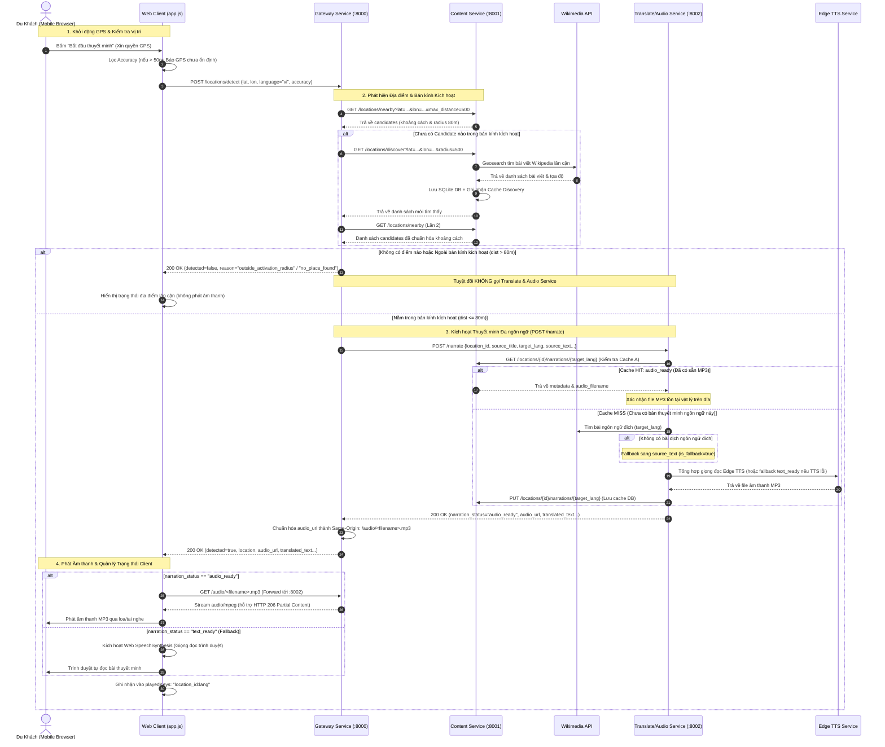

# Kiến Trúc Core Flow Toàn Hệ Thống — Tuần 5

Tài liệu đặc tả luồng hoạt động tích hợp toàn diện của hệ thống Thuyết Minh Du Lịch Đa Ngôn Ngữ Tự Động (Multilingual Dubbing Backend & Mobile Web Client).

---

## 1. Sơ Đồ Kiến Trúc & Luồng Dữ Liệu Tích Hợp

Hệ thống hoạt động theo mô hình Microservices phân tầng với **Gateway Service** đóng vai trò Reverse Proxy & Điều phối trung tâm:

```
[Mobile Web Client] (HTML5/CSS3/Vanilla JS)
       │
       │  POST /locations/detect (GPS, lang)
       │  GET /audio/<filename>.mp3 (Stream audio)
       ▼
[Gateway Service :8000] (FastAPI, Reverse Proxy, Static Files)
       │
       ├───► [Content Service :8001] (Thành viên A - SQLite Master, Discovery, Geo)
       │            │
       │            └───► [Wikimedia API] (Geosearch & Extracts)
       │
       └───► [Translate & Audio Service :8002] (Thành viên B - Localization & TTS)
                    │
                    ├───► [Content Service :8001] (Đọc/Ghi Narration Cache)
                    ├───► [Wikimedia API] (Truy xuất bài dịch đa ngôn ngữ)
                    └───► [Microsoft Edge TTS] (Tổng hợp giọng đọc chất lượng cao)
```

---

## 2. Sequence Diagram Toàn Toàn Cảnh (End-to-End Core Flow)



---

## 3. Các Luồng Cache-Hit Chi Tiết

Hệ thống tối ưu hóa hiệu năng tối đa thông qua 3 cấp độ cache phối hợp:

### 3.1. Kịch bản 1: Cực Đại Hiệu Năng (Full Cache-Hit)
- **Điều kiện**: Địa điểm đã được discover trước đó, và bài thuyết minh cho ngôn ngữ yêu cầu đã được tạo sẵn file MP3.
- **Tiến trình**:
  1. Client gửi GPS -> Gateway gọi `/locations/nearby` -> SQLite trả ngay candidate (khoảng 2ms, không gọi Wikimedia).
  2. Gateway gọi `/narrate` -> B kiểm tra SQLite của A (`GET /narrations/{lang}`) -> Trả về `audio_ready`.
  3. B kiểm tra file MP3 vật lý có sẵn trong thư mục shared volume -> Trả 200 ngay.
  4. **Kết quả**: Tổng thời gian phản hồi toàn luồng `< 30ms`, hoàn toàn **0 cuộc gọi ra ngoài Internet** (không Wikimedia, không Edge TTS).

### 3.2. Kịch bản 2: Discovery Cache-Hit
- **Điều kiện**: Khi du khách di chuyển vào ô tọa độ lân cận chưa có điểm kích hoạt, Gateway gọi `/discover`.
- **Tiến trình**:
  1. Content Service kiểm tra bảng `discovery_cache` theo lưới tọa độ làm tròn (`grid_lat, grid_lon, radius`).
  2. Nếu ô tọa độ này đã được quét trong thời gian TTL (ví dụ 1 ngày), SQLite trả ngay kết quả candidates đã lưu mà không gọi Wikimedia Geosearch API.
  3. Tránh việc gọi lặp Wikimedia khi nhiều du khách cùng đứng ở một góc phố.

### 3.3. Kịch bản 3: Text-Ready & Fallback Cache
- **Điều kiện**: Bài viết Wikipedia chưa có bản dịch tiếng Nhật (`ja`), hoặc mạng quốc tế tới Edge TTS tạm thời gián đoạn.
- **Tiến trình**:
  1. B cố gắng liên hệ Wikimedia tìm bài tiếng Nhật -> Không có -> Tự động fallback sang tiếng nguồn (`vi`), đặt cờ `is_fallback = true`, `reason = "target_language_unavailable"`.
  2. B lưu trạng thái `text_ready` vào Content Service.
  3. Client nhận được `narration_status = "text_ready"`, hiển thị nhãn dịch fallback rõ ràng và tự động chuyển giao văn bản cho Web Speech API của điện thoại phát âm thanh.

---

## 4. Ngân Sách Timeout Phân Tầng (Timeout Budget)

Để đảm bảo kết nối không bị treo vô hạn trên mạng 4G/5G di động, hệ thống thiết lập ngân sách thời gian hữu hạn tăng dần từ trong ra ngoài:

```
[Edge TTS: 15s] ──► [B Request: 25s] ──► [Gateway -> B: 30s] ──► [Client Abort: 40s]
```

| Cấp độ | Thành phần | Giá trị Timeout | Cơ chế bảo vệ |
|---|---|---|---|
| **Lõi 1** | Edge TTS API | `15 giây` | Nếu quá 15s không phản hồi, B tự động chuyển sang chế độ `text_ready` để không làm nghẽn luồng. |
| **Lõi 2** | `translate-audio-service` (B) | `25 giây` | Tổng thời gian xử lý dịch thuật, truy xuất cache và TTS nội bộ tối đa 25s. |
| **Lõi 3** | `gateway-service` (C gọi B) | `connect=5s, read=30s` | httpx Timeout kiểm soát chặt chẽ; nếu B bị đơ hoặc mạng quá tải, trả về `narration_status='error'` ngay lập tức. |
| **Lõi 4** | Web Client (Mobile Browser) | `40 giây` | `AbortController` tự động hủy request nếu toàn bộ mạng nghẽn, phục hồi giao diện cho du khách. |

---

## 5. Phân Định Rõ Ràng Hai Trách Nhiệm Chống Lặp

Hệ thống phân định rạch ròi giữa trách nhiệm của Backend và Client:

1. **Trách nhiệm Backend (Cache Engine)**:
   - Mục tiêu: **Tránh tạo file MP3 và tránh gọi Wikimedia trùng lặp giữa TẤT CẢ các người dùng khác nhau trên hệ thống**.
   - Lưu trữ: SQLite DB (bảng `locations`, `discovery_cache`, `narrations`) và thư mục đĩa lưu file MP3.
   - Khi 100 du khách cùng đến Nhà thờ Đức Bà, file MP3 chỉ được tạo 1 lần duy nhất từ du khách đầu tiên; 99 du khách sau tải từ file cache.

2. **Trách nhiệm Client (`playedKeys` & State Machine)**:
   - Mục tiêu: **Tránh làm phiền một du khách cụ thể bằng cách phát đi phát lại cùng một bài thuyết minh khi họ đang đứng yên tại chỗ**.
   - Lưu trữ: `Set<string>` trên bộ nhớ RAM của trình duyệt di động: `playedKeys = Set("location_id:lang")`.
   - Khi du khách đứng chụp ảnh 15 phút tại địa điểm (hàng chục GPS tick bắn về), bài thuyết minh **chỉ phát đúng 1 lần**.
   - Khi du khách chủ động bấm **"Phát lại"**, thao tác chủ động này sẽ bypass `playedKeys`.

---

## 6. Hysteresis Buffer & Cơ Chế Xác Nhận Rời Địa Điểm (Exit Detection)

Để loại bỏ hiện tượng giật tọa độ (GPS Jitter) ở rìa bán kính kích hoạt:
- Bán kính kích hoạt (Activation Radius): `radius` (thường là `80m`).
- Ngưỡng rời địa điểm (Exit Threshold): `radius + 30m` (thường là `110m`).
- **Quy tắc 2 Fix hợp lệ**:
  1. Khi du khách bước ra khỏi ngưỡng `> 110m`, hệ thống ghi nhận Fix thứ nhất làm candidate.
  2. Chỉ khi nhận được **Fix thứ hai hợp lệ** cách Fix thứ nhất ít nhất **>= 10 giây** mà vẫn nằm ngoài `> 110m`, hệ thống mới chính thức xác nhận du khách **ĐÃ RỜI ĐỊA ĐIỂM**.
  3. Sau khi xác nhận rời: reset `activeLocationId = null` và làm sạch `playedKeys.clear()`.
  4. Nếu du khách quay lại sau đó, bài thuyết minh sẽ được kích hoạt phát lại như một lần ghé thăm mới.
  5. **Tuyệt đối không reset `playedKeys` từ một response `detected=false` tạm thời hoặc lỗi mất sóng 4G.**

---

## 7. Xử Lý Tọa Độ Kém (Accuracy Filter) & Sequence Token

- **GPS Accuracy > 50m**:
  - Tín hiệu GPS trong hẻm hoặc dưới tán cây dày có sai số lớn.
  - Client hiển thị cảnh báo: *"Độ chính xác GPS chưa ổn định (±...m > 50m)"*.
  - Bỏ qua tọa độ này, không tạo sự kiện enter hoặc exit giả mạo.
- **Sequence Token Guard**:
  - Mỗi request detect được đánh số thứ tự tuần tự (`sequenceToken++`).
  - Nếu du khách đổi ngôn ngữ từ `vi` sang `en`, các response cũ của tiếng `vi` đang bay trên mạng khi trả về sẽ bị hủy bỏ (Discard Stale Response), ngăn chặn phát nhầm ngôn ngữ cũ.
